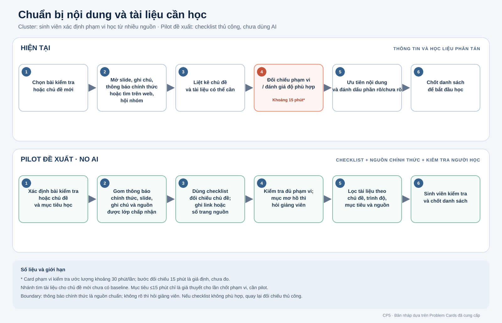

# Báo cáo nhóm — Day 02 Discovery & Problem Framing

> Bản chung của nhóm, viết trên repo do nhóm trưởng fork. Không copy file này sang repo cá nhân.
> Template chi tiết và prompt mẫu: [docs/01-worksheet.md](../../docs/01-worksheet.md). Bài mẫu: [docs/02-deliverable-example.md](../../docs/02-deliverable-example.md).

## 1. Thông tin nhóm

- Tên nhóm: B1
- Thành viên: xem `TEAM.md`
- Candidate problem đề xuất (chờ nhóm xác nhận): Sinh viên mất thời gian xác định nội dung cần học và chọn tài liệu phù hợp từ nhiều nguồn.
- Quyết định cuối: Not Yet

---

## 2. Hội tụ nhóm (CP3)

### 2.1. Pitch

| # | Người đưa ra | Candidate (Job Story ngắn) | Actor | Bottleneck | Câu hỏi phản biện nhận được (ai hỏi) |
|---:|---|---|---|---|---|
| 1 | Nguyễn Minh Quân | Khi nhóm chuẩn bị ghép bài, muốn xác định bản mới nhất đã được duyệt của từng phần để đưa đúng nội dung vào bản nộp chung. | Thành viên ghép bài và chuẩn bị bản nộp | Đối chiếu tên file, thời điểm gửi và nội dung của 4 phiên bản: khoảng 10 phút/lần (ước lượng). | Chưa có câu hỏi phản biện được ghi trong card; nhóm bổ sung sau buổi pitch. |
| 2 | Nguyễn Minh Quân | Khi chuẩn bị ôn kiểm tra, muốn xác định chủ đề trong phạm vi để phân bổ thời gian ôn đúng phần. | Sinh viên lập danh sách chủ đề ôn tập | Đối chiếu chủ đề với thông báo chính thức: khoảng 15 phút/lần (ước lượng). | Chưa có câu hỏi phản biện được ghi trong card; nhóm bổ sung sau buổi pitch. |
| 3 | Nguyễn Minh Quân | Khi nhóm cần hẹn họp, muốn biết khung giờ mọi thành viên có thể tham gia để chốt lịch. | Thành viên phụ trách hẹn lịch | Chờ đủ phản hồi: khoảng 210 phút (ước lượng); tổng thời gian đến lúc gửi lịch khoảng 240 phút. | Chưa có câu hỏi phản biện được ghi trong card; nhóm bổ sung sau buổi pitch. |
| 4 | Vũ Bá Tùng Lâm | Khi chi tiêu trong tháng, muốn theo dõi và phân loại các khoản đã dùng để biết tiền đi đâu và kiểm soát ngân sách. | Cá nhân có thu nhập hoặc sinh hoạt phí cố định | Dễ quên ghi khoản nhỏ, mất công phân loại và tổng hợp dữ liệu từ nhiều nguồn; thời gian chưa đo. | Chưa có câu hỏi phản biện được ghi trong card; nhóm bổ sung sau buổi pitch. |
| 5 | Vũ Bá Tùng Lâm | Khi bắt đầu học chủ đề mới, muốn tìm tài liệu phù hợp trình độ và mục tiêu để lập lộ trình học hiệu quả. | Sinh viên, người tự học hoặc người mới chuyển lĩnh vực | Nhiều tài liệu; khó xác định độ tin cậy, thứ tự học và mức phù hợp; thời gian chưa đo. | Chưa có câu hỏi phản biện được ghi trong card; nhóm bổ sung sau buổi pitch. |
| 6 | Vũ Bá Tùng Lâm | Khi muốn mua sản phẩm công nghệ, muốn so sánh thông tin đáng tin cậy để chọn sản phẩm phù hợp nhu cầu và ngân sách. | Người tiêu dùng cần mua sản phẩm công nghệ | Thông tin phân tán giữa website/video; khó so thông số, độ tin cậy của đánh giá và giá bán; thời gian chưa đo. | Chưa có câu hỏi phản biện được ghi trong card; nhóm bổ sung sau buổi pitch. |
| 7 | Hồ Trọng Nghĩa | Khi bắt đầu tuần mới, muốn xem lại việc tuần trước và xác định điều nên cải thiện, dừng hoặc tìm hiểu thêm để chọn thay đổi hữu ích. | Người tự quản lý công việc hằng tuần | Đánh giá chất lượng, việc tốn thời gian hoặc phải sửa: 30–60 phút (ước lượng). | Chưa có câu hỏi phản biện được ghi trong card; nhóm bổ sung sau buổi pitch. |
| 8 | Hồ Trọng Nghĩa | Khi cập nhật kiến thức đầu tuần, muốn tìm và đánh giá nghiên cứu mới đáng đọc để chọn thông tin hữu ích cho workflow. | Người tự nghiên cứu và cập nhật kiến thức | Giải thích kỹ thuật tạo hiệu quả thế nào: khoảng 10 phút (ước lượng cần xác nhận); tổng tìm/chọn khoảng 30 phút/tuần. | Chưa có câu hỏi phản biện được ghi trong card; nhóm bổ sung sau buổi pitch. |
| 9 | Hồ Trọng Nghĩa | Khi đọc paper có kỹ thuật mới, muốn hiểu cách hoạt động và hiệu quả, đồng thời đối chiếu nghiên cứu trước để đánh giá mức liên quan. | Người đọc và đánh giá paper | Đối chiếu kết quả với nghiên cứu trước: 10–15 phút/paper (ước lượng). | Chưa có câu hỏi phản biện được ghi trong card; nhóm bổ sung sau buổi pitch. |

> Bảng trên tóm tắt 9 Problem Card cá nhân để nhóm dùng làm đầu vào cho buổi pitch. Worksheet yêu cầu thành viên tự pitch và tự phản biện; các câu hỏi chưa được ghi nhận trong card nên không được suy diễn ở đây.

### 2.2. Cluster

| Cluster | Các candidate trong 9 card | Pattern chung |
|---|---|---|
| A — Review công việc cá nhân | Hồ Trọng Nghĩa #1: review tuần | Nhìn lại việc đã làm/chưa làm để điều chỉnh cách làm tuần sau. |
| B — Xác định nội dung và tài liệu học | Nguyễn Minh Quân #2: phạm vi ôn thi; Vũ Bá Tùng Lâm #2: tìm tài liệu cho chủ đề mới | Sinh viên sàng lọc nhiều nguồn để biết cần học gì và tài liệu nào phù hợp. Đây là cluster được đề xuất đưa vào shortlist. |
| C — Điều phối nhóm | Nguyễn Minh Quân #1: tìm bản cuối để ghép bài; Nguyễn Minh Quân #3: tìm giờ họp chung | Đồng bộ thông tin hoặc lịch giữa các thành viên để nhóm tiếp tục công việc. |
| D — Tìm và đánh giá thông tin để ra quyết định | Hồ Trọng Nghĩa #2: tìm nghiên cứu; Hồ Trọng Nghĩa #3: đọc/đối chiếu paper; Vũ Bá Tùng Lâm #3: so sánh sản phẩm công nghệ | Tìm, hiểu và so sánh thông tin từ nhiều nguồn trước khi quyết định; các domain khác nhau nên mức độ cùng pattern cần nhóm xác nhận. |
| E — Theo dõi chi tiêu | Vũ Bá Tùng Lâm #1: ghi nhận/phân loại chi tiêu | Tổng hợp chi tiêu cá nhân; hiện là ý đơn lẻ, chưa có card khác cùng pattern rõ. |

### 2.3. Opportunity Solution Tree rút gọn

Gốc là **1 outcome**. Nhánh là **opportunity** (nhu cầu, pain), không phải tính năng hay công cụ.

```text
OUTCOME: Giảm thời gian sinh viên cần để xác định nội dung cần học và chọn tài liệu phù hợp từ nhiều nguồn
├── Opportunity A: Khi ôn thi, chủ đề trong thông báo, slide và ghi chú khó đối chiếu để chốt phạm vi đầy đủ
├── Opportunity B: Khi học chủ đề mới, có quá nhiều tài liệu và khó biết nguồn nào đáng tin, phù hợp trình độ và nên học trước
└── Opportunity C: Khó xác định tài liệu nào tương ứng với từng chủ đề và mục tiêu học
```

> Opportunity C là hướng tổng hợp để nhóm kiểm tra thêm; nếu thành viên không xác nhận đây là pain riêng, hãy bỏ nhánh này. Metric 30→15 phút hiện chỉ là mục tiêu thử cho tình huống chốt phạm vi ôn thi; nhánh tìm tài liệu chưa có baseline riêng.

Những ý đã gạch bỏ vì là solution đội lốt opportunity:

- «AI tạo study guide», «tự động đề xuất lộ trình học» và «làm ứng dụng tổng hợp tài liệu» là solution, không phải opportunity.

### 2.4. Chấm điểm shortlist (1–5)

| Candidate | Actor rõ | Quy trình rõ | Pain có bằng chứng | Impact đo được | Vừa sức lab | So sánh được No AI/Rule/Workflow/Agent | Nhóm hiểu domain | Tổng |
|---|---:|---:|---:|---:|---:|---:|---:|---:|
| A — Review tuần (Hồ Trọng Nghĩa #1) | 5 | 5 | 3 | 4 | 5 | 5 | 3 | **30** |
| B — Nội dung và tài liệu cần học (Quân #2 + Tùng Lâm #2) | 5 | 4 | 3 | 4 | 5 | 5 | 4 | **30** |
| C — Tìm giờ họp chung (Nguyễn Minh Quân #3) | 5 | 5 | 2 | 4 | 5 | 5 | 3 | **29** |

> Điểm trên là bản chấm sơ bộ cá nhân của Hồ Trọng Nghĩa để nhóm thảo luận, chưa phải điểm đồng thuận. Pain và thời lượng chưa được phỏng vấn hoặc đo độc lập.

**Candidate đề xuất để nhóm xác nhận:** B — Sinh viên mất thời gian xác định nội dung cần học và chọn tài liệu phù hợp từ nhiều nguồn.

**Vì sao đề xuất B:** Hai card của hai thành viên cùng hướng về nhu cầu học tập; actor và quy trình đủ rõ để thử một checklist No AI, đồng thời có thể tách riêng tình huống ôn thi và tìm tài liệu mới.

**Vì sao A/C chưa ưu tiên trong shortlist:** A hiện chỉ có một card và số liệu review là ước lượng; C có tổng thời gian chờ 240 phút nhưng phần 210 phút chờ là giả định. Các cluster D/E được ghi nhận nhưng có domain rộng hoặc card đơn lẻ, nên chưa chọn làm candidate phân tích sâu.

**Xử lý bất đồng:** Chưa ghi nhận bất đồng hoặc quyết định tập thể; cập nhật sau khi nhóm chấm và thảo luận trực tiếp.

---

## 3. Kiểm chứng + research giải pháp đã có (CP4)

> Phạm vi bản nháp: cluster về sinh viên xác định nội dung và tài liệu cần học từ nhiều nguồn. Đây là working candidate theo trao đổi; nhóm cần xác nhận đây là candidate được chọn sau CP3.

### 3.1. Assumption Map

| # | Giả định | Loại (Value / Usability / Feasibility / Viability) | Quan trọng (1–5) | Đã có bằng chứng (1–5) | Kiểm chứng trước? |
|---:|---|---|---:|---:|---|
| 1 | Sinh viên mất khoảng 30 phút mỗi lần chuẩn bị danh sách nội dung cần ôn/học. | Value | 5 | 2 | Có — hiện chỉ là ước lượng trong Problem Card |
| 2 | Thông tin cần học nằm ở nhiều nguồn và việc đối chiếu làm chậm quá trình. | Value | 5 | 2 | Có — hỏi người học về lần gần nhất |
| 3 | Sinh viên khó chọn tài liệu phù hợp với trình độ, mục tiêu và độ tin cậy của nguồn. | Value / Usability | 5 | 2 | Có — hỏi về hành vi đã xảy ra |
| 4 | Có thể gom slide, ghi chú, thông báo chính thức và tài liệu tham khảo vào một quy trình kiểm tra. | Feasibility | 4 | 3 | Kiểm tra bằng một bộ tài liệu môn học thực tế |
| 5 | Công cụ tạo study guide từ nguồn được cung cấp sẽ bao quát đúng phạm vi chính thức mà không bỏ sót chủ đề. | Feasibility / Value | 5 | 1 | Có — chưa có eval hoặc thử nghiệm |
| 6 | Sinh viên có thể dùng công cụ và nguồn tài liệu theo quy định lớp/trường; chi phí và ngôn ngữ phù hợp. | Viability / Usability | 4 | 1 | Có — hỏi lớp/trường và kiểm tra hỗ trợ ngôn ngữ |

### 3.2. Kiểm chứng

**Trạng thái:** Chưa có phỏng vấn hoặc survey được thực hiện cho bản này. Không ghi dữ liệu thay cho người thật.

**Cách nhóm cần thực hiện:** phỏng vấn 2–3 sinh viên ngoài nhóm đã từng chuẩn bị cho một bài kiểm tra hoặc bắt đầu một chủ đề mới. Hỏi về lần gần nhất, quy trình thực tế, thời gian, nguồn đã dùng, điều gây khó và cách họ xử lý. Ghi snapshot sau từng cuộc trò chuyện, không hỏi họ có muốn dùng một giải pháp giả định hay không.

| Người được hỏi (vai trò, không ghi tên thật) | Câu nói đáng nhớ nhất (nguyên văn) | Lần gần nhất gặp vấn đề | Workaround hiện tại | Mất bao lâu, bao lần | Insight / opportunity |
|---|---|---|---|---|---|
| Chờ phỏng vấn người thật | Chưa thực hiện | — | — | — | — |
| Chờ phỏng vấn người thật | Chưa thực hiện | — | — | — | — |
| Chờ phỏng vấn người thật | Chưa thực hiện | — | — | — | — |

| Nguồn | Số người / số mẫu | Tín hiệu xác nhận | Tín hiệu phản bác |
|---|---:|---|---|
| Phỏng vấn sinh viên ngoài nhóm | 0 — chưa thực hiện | Chưa có dữ liệu | Chưa có dữ liệu |

**Nhóm đã sửa problem thế nào sau kiểm chứng:** Chưa thể kết luận trước khi có phỏng vấn. Sau phỏng vấn, ghi rõ thay đổi về actor, phạm vi, metric hoặc quyết định; nếu không có thay đổi, nêu bằng chứng vì sao giữ nguyên.

### 3.3. Research giải pháp đã có

Nguồn chính thức được mở và kiểm tra ngày 09/11/2026. Nhận định về khoảng trống là phân tích mức độ khớp với candidate của nhóm, không phải tuyên bố rằng sản phẩm không có tính năng khác.

| Công cụ / case / pattern | Link | Giải bước nào trong quy trình? | Điểm mạnh | Khoảng trống / rủi ro | Bài học cho nhóm |
|---|---|---|---|---|---|
| Gemini Notebook — gom nguồn và tạo study guide | [Hướng dẫn thêm/tìm nguồn](https://support.google.com/gemininotebook/answer/16215270?hl=en), [tạo notebook và báo cáo](https://support.google.com/gemininotebook/answer/16206563?hl=en) | Tìm hoặc nhập nguồn từ web/Drive; hỗ trợ PDF, Google Slides, Docs và URL; tạo báo cáo, study guide, flashcards/quizzes dựa trên nguồn đã chọn. | Có thể gom nguồn và tạo bản nháp học liệu trong cùng notebook; người học chọn nguồn được dùng. | Không thể đảm bảo danh sách nguồn đã đủ thông báo chính thức; nội dung tạo ra vẫn cần đối chiếu. Nếu nguồn không có phạm vi kiểm tra thì công cụ không thể xác nhận phạm vi đó. | Nếu thử, nguồn thông báo chính thức phải là chuẩn đối chiếu; con người xác nhận mọi mục. |
| Quizlet Study Guides | [Quizlet Help Center — Study Guides](https://help.quizlet.com/hc/en-us/articles/18312306436365-Studying-with-Study-Guides) | Người học tải hoặc dán tài liệu lớp học để tạo outline, flashcards và study guide; có thể chỉnh sửa kết quả. | Biến tài liệu đã có thành học liệu có cấu trúc; có thể sửa nội dung tạo ra. | Help Center hiện liệt kê Study Guides cho giao diện/người dùng bằng tiếng Anh, Pháp hoặc Đức; không khớp rõ với nhu cầu học liệu tiếng Việt. Công cụ cần tài liệu đầu vào và không thay thông báo chính thức để xác định phạm vi thi. | Có thể tham khảo cách biến nguồn thành outline, nhưng phải kiểm tra ngôn ngữ và không xem guide là nguồn quyết định phạm vi. |
| Anki — flashcards và spaced repetition | [Anki Manual — Background](https://docs.ankiweb.net/manual/background) | Ôn tập sau khi người học đã chọn nội dung và tạo/import flashcards. | Hỗ trợ active recall và spaced repetition; có thể chia nội dung thành deck. | Không tìm nguồn, xác định phạm vi kiểm tra hoặc đánh giá tài liệu có phù hợp mục tiêu hay không; người học phải tự chọn nội dung. | Hữu ích ở giai đoạn ghi nhớ sau khi đã chốt nội dung, không giải bottleneck tìm/chọn nội dung. |

**Nhóm đã sửa problem thế nào sau research (tạm thời):** Các công cụ hiện có xử lý tốt hơn bước tổ chức nguồn hoặc biến tài liệu đã chọn thành học liệu. Vì vậy, candidate nên tập trung vào khâu quyết định nội dung và kiểm tra độ phù hợp, không phải tự xây một ứng dụng học tập đầy đủ. Research chưa chứng minh người học có pain đủ lớn; quyết định cuối chờ kiểm chứng người thật.

---

## 4. Quy trình trước/sau (CP5)

### 4.1. Quy trình hiện tại

Bản dưới đây gộp hai tình huống trong cluster để thảo luận. Thời lượng của từng nhánh chưa được đo thống nhất; số trong Problem Card phạm vi kiểm tra là ước lượng.

Sinh viên xác định bài kiểm tra hoặc chủ đề mới
→ Mở slide, ghi chú, thông báo chính thức; hoặc tìm tài liệu trên web/cộng đồng
→ Ghi các chủ đề và tài liệu có thể cần
→ Đối chiếu phạm vi chính thức, độ liên quan, trình độ và độ tin cậy
→ Ưu tiên nội dung, đánh dấu phần chưa rõ
→ Chốt danh sách để bắt đầu học

| Bước | Actor | Input | Output | Thời gian / tần suất | Ghi chú |
|---:|---|---|---|---|---|
| 1 | Sinh viên | Môn học, bài kiểm tra hoặc chủ đề mới; mục tiêu học | Mục tiêu/phạm vi cần làm rõ | Chưa đo | Hai tình huống trong cluster có bối cảnh khác nhau |
| 2 | Sinh viên | Slide, ghi chú, thông báo; hoặc nguồn học liệu | Bộ nguồn để xem xét | Chưa đo | Card phạm vi kiểm tra nêu ba nguồn |
| 3 | Sinh viên | Bộ nguồn đã mở | Danh sách chủ đề/tài liệu có thể học | Chưa đo | Bước tạo danh sách trong card tìm tài liệu chưa có timer |
| 4 | Sinh viên | Danh sách ứng viên và thông báo chính thức/tiêu chí học | Danh sách đã đối chiếu, phần chưa rõ | Khoảng 15 phút cho đối chiếu phạm vi theo giả định trong card; tổng chuẩn bị phạm vi khoảng 30 phút/lần theo ước lượng | Bottleneck của card phạm vi kiểm tra; chưa xác nhận bằng log |
| 5 | Sinh viên; có thể hỏi giảng viên khi chưa rõ | Danh sách đã ưu tiên | Danh sách nội dung/tài liệu để bắt đầu học | Chưa đo | Không tự suy diễn phạm vi thi khi thông báo chưa rõ |

**Bottleneck chính:** Đối chiếu chủ đề giữa slide/ghi chú và thông báo chính thức (khoảng 15 phút theo giả định). Ở tình huống học chủ đề mới, bottleneck được mô tả là quá nhiều nguồn, khó đánh giá độ tin cậy, trình độ và thứ tự học; chưa có thời lượng thực tế.

### 4.2. Quy trình tương lai — pilot No AI bằng checklist

Sinh viên xác định bài kiểm tra/chủ đề và mục tiêu
→ Gom thông báo chính thức, slide/ghi chú và danh sách nguồn được lớp chấp nhận
→ Dùng checklist/bảng đối chiếu theo chủ đề, ghi link hoặc số trang nguồn
→ Sinh viên kiểm tra đủ phạm vi; đánh dấu mục mơ hồ để hỏi giảng viên
→ Với chủ đề mới, lọc danh sách học liệu theo chủ đề, trình độ, mục tiêu và nguồn gốc
→ Sinh viên chốt danh sách và bắt đầu học

**Boundary:** Chỉ thông báo chính thức của giảng viên quyết định phạm vi kiểm tra. Checklist không tự thêm/bỏ chủ đề; không rõ thì đánh dấu và hỏi người dạy. Không đưa tài liệu cá nhân/lớp lên dịch vụ bên ngoài khi chưa được phép.

**Phương án quay về:** Nếu checklist không giúp hoặc nguồn mâu thuẫn, quay lại đọc thông báo gốc, đối chiếu thủ công và hỏi giảng viên.



### 4.3. Before / after

| Chỉ số | Trước | Sau (kỳ vọng/pilot) | Ghi chú |
|---|---:|---:|---|
| Số bước | 4 bước trong card phạm vi; card tìm tài liệu có quy trình riêng | 5–6 bước theo quy trình gộp đề xuất | Chưa thể so trực tiếp trước khi nhóm thống nhất một tình huống đo |
| Tổng thời gian | Khoảng 30 phút/lần cho phạm vi kiểm tra theo card; nhánh tìm tài liệu chưa có baseline | Mục tiêu thử ≤15 phút cho một lần chốt phạm vi | Mục tiêu từ card, chưa kiểm chứng; cần đo nhánh tài liệu riêng |
| Số bước thủ công | Các bước hiện tại đều do sinh viên làm | Phần lớn vẫn do sinh viên làm; checklist chỉ chuẩn hóa đối chiếu | Không tuyên bố đã giảm thao tác khi chưa thử |
| Bottleneck chính | Đối chiếu khoảng 15 phút theo giả định; chọn nguồn phù hợp chưa đo | Kiểm tra độ đầy đủ và xử lý điểm chưa rõ | Cần đo trong pilot |
| Rủi ro mới phát sinh | Có thể ôn thiếu/thừa hoặc chọn nguồn không phù hợp | Checklist cũ/thiếu; nguồn không đáng tin; sinh viên quá tin vào danh sách | Giảm bằng nguồn chính thức, link truy xuất và bước người học kiểm tra |

---

## 5. Problem Statement v0 (CP5)

| Trường | Nội dung |
|---|---|
| **Actor** | Sinh viên chuẩn bị cho bài kiểm tra hoặc bắt đầu học một chủ đề mới. |
| **Quy trình** | Mở slide, ghi chú, thông báo chính thức và/hoặc tìm nguồn học liệu; lập danh sách chủ đề; đối chiếu phạm vi hoặc đánh giá độ phù hợp của tài liệu; ưu tiên và đánh dấu điểm chưa rõ. |
| **Bottleneck** | Đối chiếu chủ đề với thông báo chính thức mất khoảng 15 phút/lần theo giả định trong card; ở nhánh học chủ đề mới, khó lọc nhiều nguồn theo độ tin cậy, trình độ và thứ tự học nhưng chưa có timer. |
| **Impact** | Card phạm vi kiểm tra ước lượng khoảng 30 phút/lần; hiểu sai có thể khiến ôn thiếu hoặc ngoài phạm vi. Nhánh chọn tài liệu chưa có baseline thực tế. Chưa có phỏng vấn xác nhận mức độ phổ biến. |
| **Success Metric** (baseline → target, cách đo) | Baseline tạm: khoảng 30 phút/lần cho việc chốt phạm vi kiểm tra (ước lượng từ card), target thử ≤15 phút/lần. Bấm giờ từ lúc mở nguồn đầu tiên đến khi chốt danh sách; đồng thời kiểm tra mọi mục trong thông báo chính thức đều có trong danh sách và mục chưa rõ được đánh dấu. Đo riêng thời gian tìm tài liệu cho chủ đề mới trước khi gộp kết quả. |
| **Boundary** (AI không được làm gì; khi nào cần con người kiểm tra — HITL) | Trong pilot không dùng AI để quyết định phạm vi. Thông báo chính thức của giảng viên là nguồn chuẩn; sinh viên kiểm tra từng mục. Nếu nguồn mâu thuẫn hoặc không rõ, không tự suy diễn mà hỏi giảng viên. |

Phản biện nhận được và nhóm có đồng ý không:

- Bản nháp này gộp hai bối cảnh (ôn kiểm tra và học chủ đề mới); cần kiểm tra trong phỏng vấn liệu chúng thực sự chia sẻ cùng một bottleneck hay nên tách.
- Baseline 30 phút và 15 phút bottleneck là ước lượng trong card, không phải kết quả đo độc lập.

---

## 6. Mức can thiệp AI (CP6)

### 6.1. Ma trận độ mơ hồ × độ phức tạp

**Vị trí tạm thời:** độ phức tạp thấp–trung bình; độ mơ hồ thay đổi theo bước. Xác định phạm vi từ thông báo chính thức có độ mơ hồ thấp; đánh giá tài liệu phù hợp trình độ/mục tiêu có độ mơ hồ cao. Quy trình có nhiều nguồn nhưng các bước có thể định sẵn.

### 6.2. So sánh 4 mức

| Mức | Phương án cho bài của nhóm | Đủ khi nào | Rủi ro | Chọn? |
|---|---|---|---|---|
| **No AI** (sửa quy trình) | Gom thông báo chính thức, slide và ghi chú; dùng mẫu danh sách chủ đề và link tài liệu | Nguồn ít, thông báo rõ, người học chỉ cần đối chiếu có cấu trúc | Vẫn mất công tìm và so nguồn; mẫu có thể cũ | **Chọn cho pilot đầu** |
| **Rule** | Tự động map chủ đề trong thông báo sang trang slide/tài liệu bằng logic cố định | Khi mapping lặp lại, có cấu trúc rõ và checklist thủ công đã được chứng minh chưa đủ | Quy tắc có thể không bao phủ cách diễn đạt mới; cần cập nhật | Chưa chọn; xem xét sau pilot |
| **Workflow** | Nếu Rule chưa đủ: các bước định sẵn lấy nguồn đã chọn, AI đề xuất liên kết chủ đề–tài liệu, sinh viên kiểm từng đề xuất | Có bằng chứng người học vẫn mất nhiều thời gian đánh giá tài liệu sau khi checklist/nguồn đã chuẩn hóa | Ghép sai, bỏ sót, tạo độ tin cậy giả; cần kiểm nguồn gốc | Chưa chọn; chỉ cân nhắc sau pilot |
| **Agent** | Tự tìm nguồn, quyết định phạm vi, xếp thứ tự và lập lộ trình học | Không thấy nhu cầu tự quyết bước tiếp theo; nguồn/tiêu chí cần người kiểm | Có thể chọn sai phạm vi hoặc nguồn, khó kiểm soát và truy vết | Không chọn |

**Mức chọn tạm:** No AI — mẫu/checklist và cách làm thủ công có cấu trúc; chưa có bằng chứng cần automation hoặc AI.

**Vì sao chưa chọn mức cao hơn:** Phạm vi thi cần bám thông báo chính thức; checklist/bảng đối chiếu có thể xử lý phần đúng-sai rõ. Chọn tài liệu có yếu tố phán đoán, nhưng nhóm chưa kiểm chứng đây là pain phổ biến hoặc Rule/nguồn tuyển chọn không đủ. Gemini Notebook và Quizlet cho thấy có thể tạo học liệu từ nguồn đầu vào, nhưng không thay bước kiểm tra nguồn chuẩn.

### 6.3. Lý do chọn No AI

Theo worksheet, nhóm chọn No AI thì không cần AI Canvas. Pilot dùng mẫu/checklist và quy trình đối chiếu thủ công vì phạm vi kiểm tra phải truy về thông báo chính thức; mọi mục mơ hồ do sinh viên hỏi giảng viên. Chỉ cân nhắc Rule hoặc AI nếu dữ liệu pilot cho thấy cách làm này không giảm thời gian hoặc bước tìm tài liệu vẫn là bottleneck.

### 6.4. Hai câu hỏi Google PAIR

Theo worksheet, không bắt buộc điền PAIR khi chọn No AI. Lý do: pilot đầu không giao quyết định cho AI; sinh viên tự chốt nội dung và chịu trách nhiệm kiểm tra nguồn.

### 6.5. Tiêu chí đánh giá phương án No AI (3–5 tiêu chí)

| # | Tiêu chí | Đạt khi | Không đạt khi |
|---:|---|---|---|
| 1 | Đủ phạm vi chính thức | Mọi mục trong thông báo chính thức được đánh dấu trong danh sách | Thiếu bất kỳ mục nào trong thông báo |
| 2 | Truy xuất được nguồn | Mỗi chủ đề có link thông báo hoặc vị trí slide/ghi chú | Có chủ đề không chỉ ra được căn cứ |
| 3 | Xử lý chỗ chưa rõ | Mục mơ hồ được đánh dấu để hỏi giảng viên | Tự suy diễn rồi ghi thành phạm vi chắc chắn |
| 4 | Thời gian | Chốt danh sách phạm vi trong ≤15 phút ở pilot | Vượt mục tiêu sau khi đã chuẩn hóa nguồn |
| 5 | Phù hợp học liệu | Tài liệu có chủ đề, trình độ/mục tiêu và nguồn gốc được ghi rõ | Tài liệu không rõ nguồn hoặc không khớp mục tiêu |

---

## 7. Problem Statement v1 + tiêu chí đánh giá (CP6)

| Trường | Nội dung |
|---|---|
| **Actor** | Sinh viên chuẩn bị cho bài kiểm tra hoặc bắt đầu học một chủ đề mới. |
| **Quy trình** | Mở thông báo chính thức, slide/ghi chú và nguồn học liệu; lập danh sách; đối chiếu phạm vi và độ phù hợp; đánh dấu điểm chưa rõ; chốt danh sách. |
| **Bottleneck** | Đối chiếu phạm vi khoảng 15 phút/lần theo giả định; lựa chọn tài liệu phù hợp chưa có baseline. |
| **Impact** | Chuẩn bị phạm vi được ước lượng khoảng 30 phút/lần; có nguy cơ ôn thiếu/thừa. Chưa có dữ liệu người học xác nhận. |
| **Success Metric** (baseline → target, cách đo) | Baseline tạm khoảng 30 phút/lần → mục tiêu thử ≤15 phút/lần cho chốt phạm vi; đo bằng timer từ khi mở nguồn đầu tiên đến khi hoàn tất danh sách. Theo dõi riêng thời gian chọn tài liệu và tỷ lệ chủ đề chính thức bị bỏ sót. |
| **Boundary** | Không dùng AI trong pilot. Checklist không tự thêm/bỏ chủ đề; thông báo chính thức là nguồn chuẩn; người học kiểm tra từng dòng và hỏi giảng viên nếu nguồn mâu thuẫn. |
| **AI intervention point** | Không có trong pilot đầu. Chỉ xem xét workflow AI sau khi có bằng chứng Rule không đủ và có nguồn đầu vào đáng tin. |
| **Mức chọn** | No AI (mẫu/checklist và quy trình đối chiếu thủ công). |
| **Rủi ro & người kiểm tra** | Bỏ sót hoặc ghi sai phạm vi: sinh viên đối chiếu thông báo chính thức; mục chưa rõ chuyển giảng viên xác nhận. Nguồn học liệu không phù hợp: sinh viên kiểm tra chủ đề, trình độ, mục tiêu và ngày/nguồn xuất bản. |

**Thay đổi so với v0 và lý do:**

| Trường | v0 | v1 | Vì sao đổi |
|---|---|---|---|
| Mức can thiệp | Chưa chọn giải pháp | Rule/checklist trong pilot; không có điểm AI | Chưa có bằng chứng mức đơn giản không đủ; phạm vi thi cần căn cứ chính thức |
| Boundary | Giới hạn AI và HITL dự kiến | Không dùng AI trong pilot; con người kiểm từng mục | Giảm rủi ro chọn sai phạm vi trong khi chưa có eval/validation |

---

## 8. Quyết định (CP6)

### 8.1. Bốn rủi ro

| Rủi ro | Câu hỏi | Mức độ rủi ro (Thấp = an toàn / TB / Cao = nguy hiểm) | Lý do / bằng chứng |
|---|---|---|---|
| **Value** | Người dùng có thật sự cần và sẽ dùng không? | Cao | Chưa có interview/survey; các thời lượng và hậu quả hiện đến từ Problem Cards, một phần ghi là giả định. |
| **Usability** | Người dùng có dùng được, có hiểu và sửa được đầu ra không? | Trung bình | Checklist đơn giản nhưng chưa được sinh viên ngoài nhóm thử; mức phù hợp ngôn ngữ/tài liệu chưa kiểm tra. |
| **Feasibility** | Có đủ dữ liệu, công cụ, kỹ năng để làm không? | Trung bình | Có thông báo, slide và tài liệu mẫu theo card; chưa thử map một bộ môn đầy đủ hoặc đo thời gian. |
| **Viability** | Có hợp chi phí, pháp lý, quy định tổ chức không? Ai vận hành? | Trung bình | Pilot No AI ít chi phí, nhưng chưa xác nhận quyền dùng/chia sẻ tài liệu lớp và người cập nhật checklist. |

### 8.2. Kết luận

**Quyết định tạm:** Not Yet — kiểm chứng pain và baseline trước khi coi đây là giải pháp đã được xác nhận.

**Lý do:** Rủi ro Value đang Cao vì chưa có người học ngoài nhóm xác nhận. Research cho thấy công cụ có thể tổ chức nguồn hoặc tạo học liệu, nhưng không chứng minh sinh viên gặp vấn đề đủ thường xuyên hay nội dung tạo ra chính xác.

**Nếu Not Yet — cần kiểm chứng gì trước:**

- Phỏng vấn 2–3 sinh viên ngoài nhóm về một lần gần nhất họ chuẩn bị phạm vi thi hoặc chọn tài liệu học.
- Đo thời gian thực tế từ lúc mở nguồn đến khi chốt danh sách; giữ riêng số liệu cho hai tình huống.
- Thử checklist No AI trên một bộ môn và đối chiếu với thông báo chính thức.

**Pilot nhỏ nhất sau kiểm chứng:** Dùng checklist No AI cho một môn học và một lần chuẩn bị; ghi thời gian từng bước, mọi mục bị bỏ sót/ghi thừa và số câu hỏi cần hỏi giảng viên.

**Ngưỡng dừng:** Nếu có bất kỳ chủ đề nào trong thông báo chính thức bị bỏ sót, dừng dùng danh sách đó và sửa checklist trước lần tiếp theo. Nếu sau 3 lần thử, thời gian trung vị vẫn trên 15 phút hoặc sinh viên không thấy bước này gây khó, thu hẹp/đổi candidate thay vì thêm AI.---

## 9. Hạn chế và hướng tiếp theo

- **CP3 chưa được nhóm xác nhận đầy đủ:** bảng pitch hiện tổng hợp 9 Problem Card cá nhân làm đầu vào; câu hỏi phản biện, cluster cuối cùng, OST và bảng chấm điểm cần được nhóm hoàn tất sau khi thảo luận trực tiếp.
- **Chưa có kiểm chứng người dùng:** chưa phỏng vấn hoặc khảo sát sinh viên ngoài nhóm. Các nhận định về tần suất, mức độ khó và tác động hiện chưa đại diện cho người học khác.
- **Số liệu thời gian phần lớn là ước lượng:** mốc khoảng 30 phút/lần và bottleneck đối chiếu khoảng 15 phút/lần đến từ Problem Card về phạm vi ôn kiểm tra; chưa có log bấm giờ. Nhánh tìm tài liệu cho chủ đề mới chưa có baseline, nên không gộp hai tình huống để tuyên bố mức giảm thời gian.
- **Research giải pháp không chứng minh nhu cầu:** nguồn sản phẩm được dùng để hiểu khả năng và khoảng trống tương đối của công cụ, không thay thế phỏng vấn hay thử nghiệm với người học.
- **Pilot chưa được thực hiện:** No AI checklist và ngưỡng đánh giá là phương án đề xuất. Cần thử trên một môn học, đối chiếu mọi mục với thông báo chính thức, ghi thời gian từng bước và lỗi bỏ sót/ghi thừa trước khi kết luận.
- **Hướng tiếp theo:** nhóm hoàn tất CP3; phỏng vấn 2–3 sinh viên ngoài nhóm về lần gần nhất họ xác định phạm vi ôn hoặc tìm tài liệu; chọn một tình huống để pilot trước, đo riêng các tình huống còn lại, rồi cập nhật Problem Statement và quyết định Go / Not Yet / No-Go theo bằng chứng.

## 10. Tài liệu tham khảo

- Nhóm B1. [Worksheet — hướng dẫn chi tiết từng checkpoint](../../docs/01-worksheet.md). Tài liệu hướng dẫn và tiêu chí checkpoint được dùng để cấu trúc báo cáo.
- Nhóm B1. [Framework quốc tế dùng trong lab](../../docs/03-international-frameworks.md). Bản đồ framework và nguồn đọc thêm cho các phương pháp trong CP1–CP6.
- Intercom. [How we accidentally invented Job Stories](https://www.intercom.com/blog/accidentally-invented-job-stories/). Job Story.
- Torres, Teresa. [Opportunity Solution Trees](https://www.producttalk.org/opportunity-solution-trees/). Opportunity Solution Tree.
- Strategyzer. [How Assumptions Mapping Can Focus Your Team on Running Experiments That Matter](https://www.strategyzer.com/library/how-assumptions-mapping-can-focus-your-teams-on-running-experiments-that-matter). Assumption Map.
- Fitzpatrick, Rob. [The Mom Test](https://www.momtestbook.com/). Phỏng vấn về hành vi và trải nghiệm đã xảy ra.
- Gothelf, Jeff. [Business Problem vs Opportunity Statements](https://jeffgothelf.com/blog/business-problem-statement-opportunity-statement/). Problem Statement.
- Google PAIR. [People + AI Guidebook — User Needs](https://pair.withgoogle.com/chapter/user-needs/). Nhu cầu người dùng và thiết kế tương tác người–AI.
- Anthropic. [Building Effective Agents](https://www.anthropic.com/research/building-effective-agents). Phân biệt workflow và agent, lựa chọn mức độ tự chủ.
- Agrawal, Ajay, Joshua Gans, and Avi Goldfarb. [A Simple Tool to Start Making Decisions with the Help of AI](https://hbr.org/2018/04/a-simple-tool-to-start-making-decisions-with-the-help-of-ai). AI Canvas.
- Cagan, Marty. [The Four Big Risks](https://www.svpg.com/four-big-risks/). Value, Usability, Feasibility và Viability.
- Google. “Add or discover new sources for your notebook.” *Gemini Apps Help*. Truy cập 09/11/2026. https://support.google.com/gemininotebook/answer/16215270?hl=en
- Google. “Create a notebook and generate reports, study guides, and more.” *Gemini Apps Help*. Truy cập 09/11/2026. https://support.google.com/gemininotebook/answer/16206563?hl=en
- Quizlet. “Studying with Study Guides.” *Quizlet Help Center*. Truy cập 09/11/2026. https://help.quizlet.com/hc/en-us/articles/18312306436365-Studying-with-Study-Guides
- Anki. “Background.” *Anki Manual*. Truy cập 09/11/2026. https://docs.ankiweb.net/manual/background
